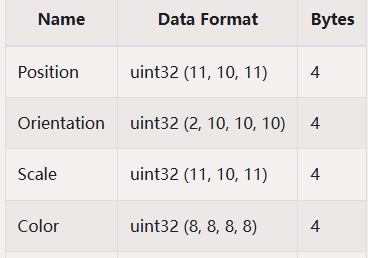
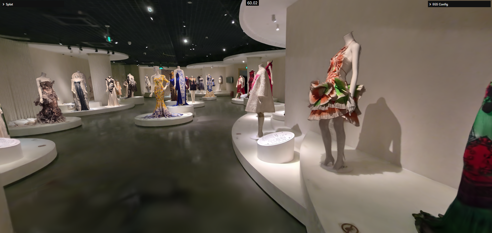
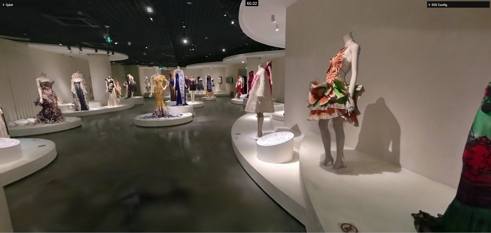
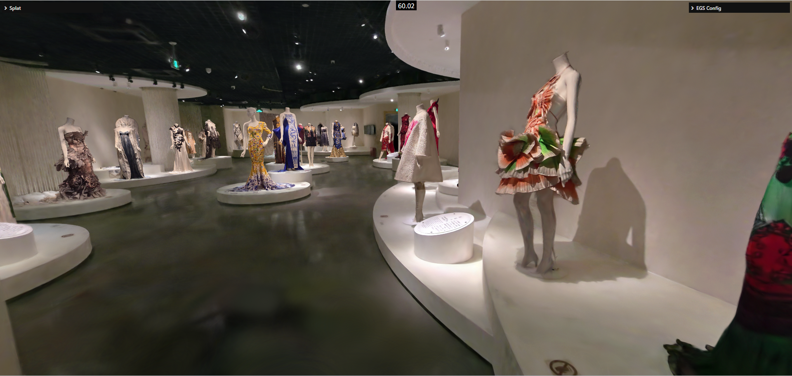
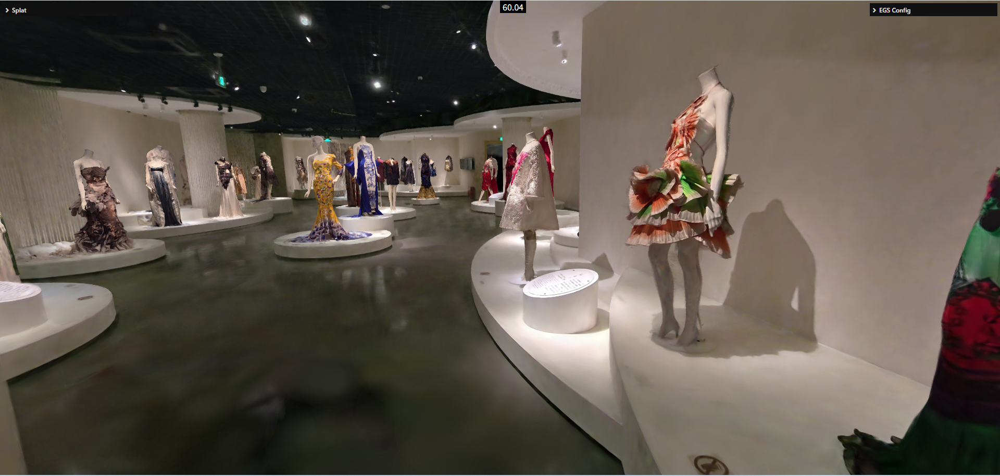
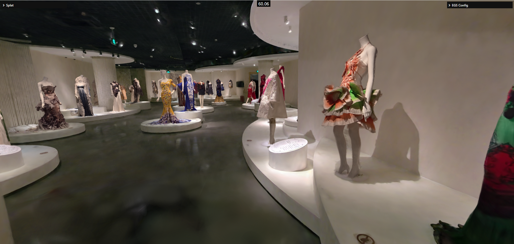

## Background

No single configuration covers every 3DGS scene. Scenes can differ significantly in data precision, file size, GPU memory usage, device performance, and image quality requirements, so choose a configuration set that matches the business target.

This page summarizes common data formats, `packType` differences, preset options, and the parameters you can tune after choosing a preset.

## Quick Choice

Choose the preset according to product constraints first, then tune only the most important parameters. Avoid changing precision, sorting, and blur parameters at the same time at the start.

| Target Scenario                                           | Recommended Preset    | Key Settings                                                                                             |
| --------------------------------------------------------- | --------------------- | -------------------------------------------------------------------------------------------------------- |
| Image quality first, with strong user hardware            | Max Quality           | `compressed`, `pack.highPrecisionEnabled`, `composite.highPrecisionEnabled`, `sort.highPrecisionEnabled` |
| Large scenes that can fail under low precision            | Quality First         | `compressed`, `pack.highPrecisionEnabled`                                                                |
| Weaker devices that still need to open large-scale scenes | Balanced              | `super-compressed`, `pack.cameraRelativeEnabled`                                                         |
| Weaker devices that still need a mostly complete image    | Performance First     | `super-compressed`, `raster.detailCullingThreshold`, `raster.maxPixelRadius`                             |
| Very large scenes or very low-end devices                 | Extreme Performance 0 | `maxShDegree: 0`, `sort.minIntervalMs`, more aggressive precision compression                            |
| Source data is sog and the goal is to open larger scenes  | Extreme Performance 1 | `sog`, `pack.precalculateEnabled`, GPU memory usage                                                      |

## 3DGS File Formats

| Format           | Size                      | Render Quality               | Implementation Notes                                                                                                                                                                                                                                |
| ---------------- | ------------------------- | ---------------------------- | --------------------------------------------------------------------------------------------------------------------------------------------------------------------------------------------------------------------------------------------------- |
| `ply`            | 100%                      | Good                         | High original precision and the largest file size.                                                                                                                                                                                                  |
| `compressed ply` | 30%, about 17% after gzip | Good                         | Uses 256 splats per chunk and is likely spatially partitioned similarly to ksplat. `center`, `quat`, `scale`, and `rgb` are compressed by min/max, rescale, and quantization. SH can be compressed to u8; observed data is about 5 bit.             |
| `spz`            | 10%                       | Average                      | Retains relatively high precision for core splat data, especially `center`, so sharpness loss is lower. SH precision is very low and can cause visible color shifts in fine-detail scenes.                                                          |
| `splat`          | 14%                       | Average, not universal       | Drops `shN` during compression. Layout: `center.xyz (f32)`, `scale.xyz (f32)`, `color.rgba (u8)`, `quat (u8)`, 32 bytes in total.                                                                                                                   |
| `ksplat`         | 20%-30%                   | Depends on compression level | Level 0 is uncompressed, level 1 is 16 bit, and level 2 is 8 bit. It spatially clusters splats for local coordinate compression, following a similar approach to compressed ply.                                                                    |
| `sog`            | 5%                        | Average                      | Applies PLAS sorting to `center`, `scales`, `quats`, and `sh0(rgba)`, then computes min/max values and quantizes the data. `shN` uses k-means clustering with centroids and labels to restore data while reducing size. Images tend to be blurrier. |

### compressed ply Quantization Example



## packType

`packType` controls the data precision generated when parsing splats. Different settings trade off size, quality, and performance.

### Compressed

| Field           | Precision    |
| --------------- | ------------ |
| `position`      | `f32 (3)`    |
| `scale`         | `f16 (3)`    |
| `quat`          | `f16 (4)`    |
| `color & alpha` | `f16 (4)`    |
| `shN`           | `s_11_10_11` |

`Compressed` favors image quality and data precision. Use it for quality-sensitive output, large scenes, or scenes that show artifacts at lower precision.

### SuperCompressed

| Field           | Precision                              |
| --------------- | -------------------------------------- |
| `position`      | `f16 (3)`                              |
| `scale`         | `u8 (3)`                               |
| `quat`          | `u8 (4)`                               |
| `color & alpha` | `u8 (4)`                               |
| `shN`           | `sh1 (sint5)`, `sh2` and `sh3 (sint4)` |

`SuperCompressed` favors file size, memory, and GPU memory control. Use it when resources are constrained, devices are lower-end, or performance is the priority.

### Sog

`Sog` is for sog data. It has the smallest size, but the image can look blurrier. Prefer it when the source format is sog and the data has no `shN`, or when extreme scene scale is required.

## Preset List

| Preset                | Recommended Scenario                                                                                                                                                         |
| --------------------- | ---------------------------------------------------------------------------------------------------------------------------------------------------------------------------- |
| Max Quality           | Use when image quality has the highest priority and the device is very powerful.                                                                                             |
| Quality First         | Use when image quality matters and device performance is still acceptable.                                                                                                   |
| Balanced              | Use when image quality requirements are low and device performance is limited, but large scenes still need to be supported.                                                  |
| Performance First     | Use when image quality requirements are low and device performance is limited.                                                                                               |
| Extreme Performance 0 | Use on extremely low-end devices or for extremely large scenes.                                                                                                              |
| Extreme Performance 1 | Use on extremely low-end devices or for extremely large scenes when the source data is sog. Prefer this preset when the condition is met, because it can open larger scenes. |

Gaussian falloff always uses the normalized `fastExp` formula, so presets no longer configure `normalizedFalloff`. `detailCullingAlphaEnabled` defaults to `false`; enable it separately to account for opacity.

### Max Quality

```typescript
// set parser config
const splatData = await SplatLoader.parseSplatData(
    // file type and data
    splatFileType,
    content,
    // compress config
    SplatLoader.SplatPackType.Compressed,
);
const splat = await SplatUtils.createSplat(splatData);
splat.autoFreeResourceOnGpuPacked = true;
viewer.getScene().add(splat);

// update viewer config
setViewerConfig(viewer, {
    pipeline: {
        Splatting: {
            pack: {
                highPrecisionEnabled: true,
                cameraRelativeEnabled: false,
            },
            raster: {
                detailCullingThreshold: 0,
            },
            sort: {
                highPrecisionEnabled: true,
            },
            composite: {
                enabled: true,
                highPrecisionEnabled: true,
            },
        },
    },
});
```



### Quality First

```typescript
// set parser config
const splatData = await SplatLoader.parseSplatData(
    // file type and data
    splatFileType,
    content,
    // compress config
    SplatLoader.SplatPackType.Compressed,
);
const splat = await SplatUtils.createSplat(splatData);
splat.autoFreeResourceOnGpuPacked = true;
viewer.getScene().add(splat);

// update viewer config
setViewerConfig(viewer, {
    pipeline: {
        Splatting: {
            pack: {
                highPrecisionEnabled: true,
                cameraRelativeEnabled: false,
            },
        },
    },
});
```



### Balanced

```typescript
// set parser config
const splatData = await SplatLoader.parseSplatData(
    // file type and data
    splatFileType,
    content,
    // compress config
    SplatLoader.SplatPackType.SuperCompressed,
);
const splat = await SplatUtils.createSplat(splatData);
viewer.getScene().add(splat);

// update viewer config
setViewerConfig(viewer, {
    pipeline: {
        Splatting: {},
    },
});
```

### Performance First

```typescript
// set parser config
const splatData = await SplatLoader.parseSplatData(
    // file type and data
    splatFileType,
    content,
    // compress config
    SplatLoader.SplatPackType.SuperCompressed,
);
const splat = await SplatUtils.createSplat(splatData);
splat.autoFreeResourceOnGpuPacked = true;
viewer.getScene().add(splat);

// update viewer config
setViewerConfig(viewer, {
    pipeline: {
        Splatting: {
            pack: {
                cameraRelativeEnabled: false,
            },
            raster: {
                maxStdDev: Math.sqrt(5),
            },
        },
    },
});
```



### Extreme Performance 0

```typescript
// set parser config
const splatData = await SplatLoader.parseSplatData(
    // file type and data
    splatFileType,
    content,
    // compress config & sh
    SplatLoader.SplatPackType.SuperCompressed,
    {
        maxShDegree: 0,
    },
);
const splat = await SplatUtils.createSplat(splatData);
splat.autoFreeResourceOnGpuPacked = true;
viewer.getScene().add(splat);

// update viewer config
setViewerConfig(viewer, {
    pipeline: {
        Splatting: {
            pack: {
                precalculateEnabled: false,
                cameraRelativeEnabled: false,
            },
            raster: {
                detailCullingThreshold: 4,
                maxStdDev: Math.sqrt(5),
            },
            sort: {
                minIntervalMs: 160,
            },
        },
    },
});
```



### Extreme Performance 1

```typescript
// set parser config
const splatData = await SplatLoader.parseSplatData(
    // file type and data
    SplatLoader.SplatFileType.SOG,
    content,
    // compress config & sh
    SplatLoader.SplatPackType.Sog,
    {
        maxShDegree: 0,
    },
);
const splat = await SplatUtils.createSplat(splatData);
splat.autoFreeResourceOnGpuPacked = true;
viewer.getScene().add(splat);

// update viewer config
setViewerConfig(viewer, {
    pipeline: {
        Splatting: {
            pack: {
                precalculateEnabled: false,
                cameraRelativeEnabled: false,
            },
            raster: {
                detailCullingThreshold: 4,
                maxStdDev: Math.sqrt(5),
            },
            sort: {
                minIntervalMs: 160,
            },
        },
    },
});
```



## Custom Configuration

Presets cannot cover every scene. In real integrations, choose the closest preset as the starting point, then tune a small number of key parameters.
Parameters can be adjusted through the [config](../config/) API:

```typescript
setViewerConfig(viewer, {
    pipeline: {
        Splatting: {
            // ... options..
        },
    },
});
```

| Parameter                                      | Purpose                                           | Recommendation                                                                                                                                                                                                                                                                                                                 |
| ---------------------------------------------- | ------------------------------------------------- | ------------------------------------------------------------------------------------------------------------------------------------------------------------------------------------------------------------------------------------------------------------------------------------------------------------------------------ |
| `pack.highPrecisionEnabled`                    | Enables high-precision data merging.              | Determines the final data precision used for rendering. Usually enable it for `compressed`; evaluate it per scene for `sog`.                                                                                                                                                                                                   |
| `pack.precalculateEnabled`                     | Enables spherical-harmonic color precalculation.  | Computes SH color contributions for the current view direction. Data without higher-order SH has no view-dependent color contribution.                                                                                                                                                                                         |
| `pack.cameraRelativeEnabled`                   | Enables camera-relative position packing.         | If center values are large but the device cannot afford `highPrecisionEnabled`, try enabling it. When enabled, packing can run on demand on the GPU, so disable `autoFreeResourceOnGpuPacked` to avoid repeated texture uploads. LOD data already needs repeated packing, so it can use this path without the same extra cost. |
| `composite.enabled`                            | Enables offscreen composition and tone mapping.   | Disabled by default. Enable it to use a tone curve, exposure, or a high-precision intermediate buffer.                                                                                                                                                                                                                         |
| `composite.toneMapping` / `composite.exposure` | Controls the tone curve and exposure.             | Defaults to `ToneMapping.Linear` and `1`. Move the former `Splatting.toneMapping` settings here; see [configuration migration](./config.md).                                                                                                                                                                                   |
| `composite.highPrecisionEnabled`               | Enables a high-precision render attachment.       | Consider enabling it when the scene shows ripple-like banding artifacts, or when quality is important. It increases GPU memory usage.                                                                                                                                                                                          |
| `raster.detailCullingAlphaEnabled`             | Includes Gaussian opacity in detail culling.      | Defaults to `false`. Enabling it makes low-opacity Gaussians more likely to be culled; evaluate it together with `detailCullingThreshold`.                                                                                                                                                                                     |
| `raster.preBlurAmount` / `raster.blurAmount`   | Controls blur parameters.                         | Non-AA training results usually use `0.3 / 0`; AA training results usually use `0 / 0.3`. Other values are not recommended.                                                                                                                                                                                                    |
| `raster.focalAdjustment`                       | Adjusts splat spread scale.                       | `2` is closer to the reference result.                                                                                                                                                                                                                                                                                         |
| `raster.detailCullingThreshold`                | Approximate detail culling.                       | Usually in `[0, 4]`. Setting it to `1` usually causes minimal visual loss; the performance gain depends on scene detail.                                                                                                                                                                                                       |
| `raster.maxPixelRadius`                        | Maximum screen-space range covered by a Gaussian. | Default is `1024`; the recommended range is `[128, 1024]`. Too small a value can make the scene look broken.                                                                                                                                                                                                                   |
| `raster.maxStdDev`                             | Maximum standard deviation of Gaussian spread.    | Should be between `sqrt(5)` and `sqrt(9)`. Larger values cost more performance but improve quality; `sqrt(8)` is usually a practical quality/performance midpoint.                                                                                                                                                             |
| `sort.highPrecisionEnabled`                    | Controls sorting precision.                       | When enabled, sorting uses float precision. In most rendering scenes, the visual improvement is small.                                                                                                                                                                                                                         |
| `sort.minIntervalMs`                           | Minimum interval between sorting operations.      | Increasing it reduces sort frequency but can delay ordering updates during fast motion. Start with `16 * n` ms, typically with `n` no greater than `10`; the default is `0`.                                                                                                                                                   |

### Disable SH per Gaussian

[`SplatState.DisableSH`](api:SplatState) disables view-dependent SH color contributions for selected Gaussians while retaining their base color. Create a [`SplatUtils.SplatOperator`](api:SplatUtils.SplatOperator) with the parsed data corresponding to `splat`, then set the state bit:

```typescript
import { SplatState, SplatUtils } from '@manycore/aholo-viewer';

const operator = new SplatUtils.SplatOperator(splat, splatData);
operator.setState([0], SplatState.DisableSH);
viewer.render();
```

`[0]` is the index of the first Gaussian. Call `operator.setState([0], SplatState.DisableSH, true)` to clear the bit and restore SH color, then render again. This does not remove loaded SH data or change other Gaussians' states. `pack.precalculateEnabled` still controls SH precalculation for the entire pipeline.
