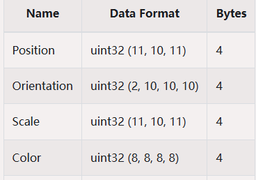

## Choose a Preset

[Viewer](./viewer.md) defaults to **Quality First**. There are five presets, with a single Extreme Performance tier. Choose a starting point for your scene and device, then validate image quality and performance on the target hardware.

| Preset                  | Configuration                                                                                                    |
| ----------------------- | ---------------------------------------------------------------------------------------------------------------- |
| Max Quality             | Compressed, SH 3, high-precision packing, offscreen composition, and a high-precision composition buffer         |
| Quality First (default) | Compressed, SH 3, and high-precision packing, with offscreen composition disabled                                |
| Balanced                | SuperCompressed and SH 3, with camera-relative coordinates and source resources retained for subsequent packing  |
| Performance First       | SuperCompressed and SH 3, with a smaller Gaussian cutoff and alpha-aware detail culling                          |
| Extreme Performance     | SuperCompressed and SH 0, with SH precalculation disabled, a higher culling threshold, and less frequent sorting |

## Preset Parameters

Switching presets changes only these **12 parameters**. `packType` and `maxShDegree` are parsing options; `splat.autoFreeResourceOnGpuPacked` is an object property. `pack`, `raster`, `sort`, and `composite` belong to `pipeline.Splatting`. Group prefixes distinguish repeated panel labels such as `enabled` and `highPrecisionEnabled`.

| Parameter                           | Max Quality | Quality First | Balanced        | Performance First | Extreme Performance |
| ----------------------------------- | ----------- | ------------- | --------------- | ----------------- | ------------------- |
| `packType`                          | Compressed  | Compressed    | SuperCompressed | SuperCompressed   | SuperCompressed     |
| `maxShDegree`                       | 3           | 3             | 3               | 3                 | 0                   |
| `pack.highPrecisionEnabled`         | true        | true          | false           | false             | false               |
| `pack.precalculateEnabled`          | true        | true          | true            | true              | false               |
| `pack.cameraRelativeEnabled`        | false       | false         | true            | false             | false               |
| `splat.autoFreeResourceOnGpuPacked` | true        | true          | false           | true              | true                |
| `raster.detailCullingThreshold`     | 1           | 1             | 1               | 1                 | 4                   |
| `raster.detailCullingAlphaEnabled`  | false       | false         | false           | true              | true                |
| `raster.maxStdDev`                  | 8           | 8             | 8               | 5                 | 5                   |
| `sort.minIntervalMs`                | 0           | 0             | 0               | 0                 | 160                 |
| `composite.enabled`                 | true        | false         | false           | false             | false               |
| `composite.highPrecisionEnabled`    | true        | false         | false           | false             | false               |

The `raster.maxStdDev` row uses **Viewer panel values**: 8 and 5 are passed to the SDK as `Math.sqrt(8)` and `Math.sqrt(5)`. `sort.minIntervalMs` is in milliseconds. Max Quality and Quality First both use `detailCullingThreshold = 1`. Performance First and Extreme Performance both enable `detailCullingAlphaEnabled`.

## Shared Parameters

These **25 parameters** remain unchanged when switching presets. Editing them retains the selected preset; editing a parameter in the previous table selects Custom. Selecting Custom itself changes no values. The reset icon restores Quality First and every shared default.

| Parameter                        | Viewer default |
| -------------------------------- | -------------- |
| `pixelRatio`                     | 1              |
| `pack.repackEnabled`             | true           |
| `raster.preBlurAmount`           | 0.3            |
| `raster.blurAmount`              | 0              |
| `raster.focalAdjustment`         | 2              |
| `raster.maxPixelRadius`          | 1024           |
| `sort.radial`                    | false          |
| `sort.sortSplatDistance`         | 0.1            |
| `sort.sortSplatCoorient`         | 0.99999        |
| `sort.sortCameraDistance`        | 1              |
| `sort.sortCameraCoorient`        | 0.99           |
| `composite.toneMapping`          | Linear         |
| `composite.exposure`             | 1              |
| `highlightKernel.enabled`        | false          |
| `highlightKernel.size`           | 2              |
| `highlightKernel.color`          | #0000ff        |
| `LOD.minLevel`                   | 0              |
| `LOD.movingMinLevel`             | 2              |
| `LOD.maxBudget`                  | 6000000        |
| `LOD.pixelLimitEnabled`          | true           |
| `LOD.frustumCullingEnabled`      | true           |
| `LOD.hysteresisTicks`            | 4              |
| `LOD.schedulerParallelCounts`    | 8              |
| `LOD.schedulerExistingTaskLimit` | 64             |
| `LOD.schedulerMinDuration`       | 160            |

These are **Viewer defaults**, not SDK-wide defaults. Viewer enables `pack.repackEnabled` and disables `sort.radial`. The panel's `pixelRatio` represents the actual rendering scale; Viewer passes `pixelRatio / window.devicePixelRatio` to the SDK. `highlightKernel.color` is a hex color in the panel and a number in the SDK. `LOD.*` maps to `LodSplat.setConfig()` fields, outside `pipeline.Splatting`.

## Application Timing and Cache

- **At import**: `packType` and `maxShDegree` affect subsequent parsing. Loaded assets are not repacked automatically. For comparisons, choose each view's preset before importing the same resources into all views.
- **At render time**: Other render settings apply to the active view. `autoFreeResourceOnGpuPacked` applies to regular Splat objects; LOD options configure the LOD scheduler. If a loaded asset has SH 0, applying a preset or restoring defaults keeps `precalculateEnabled = false`.
- **On restore**: Each view caches its parameters in the current browser with version `v1`. Missing or mismatched versions use defaults. Switching presets preserves shared parameters; restoring defaults resets both. Model files are not included in the configuration cache.

These parsing options apply to regular GS files. The current Viewer LOD path parses chunks as Compressed, with SH determined by the generated LOD data. The panel's `packType` and `maxShDegree` do not re-encode LOD data.

## File Format and packType

The source format defines storage and transfer encoding; `packType` defines the parsed runtime layout. They are separate choices: a SOG file can also be parsed into Compressed or SuperCompressed. Changing `packType` cannot recover precision or SH already lost in the source file.

| Source file          | Notes                                                                                                  |
| -------------------- | ------------------------------------------------------------------------------------------------------ |
| PLY / compressed PLY | Common Gaussian PLY and compressed PLY are supported; precision and size depend on the export encoding |
| SPZ / KSPLAT         | Compressed Gaussian formats; SH and quantization depend on the file contents                           |
| SPLAT                | 32-byte base Gaussian records, without higher-order SH                                                 |
| SOG                  | Image-based encoding; can use the Sog runtime layout or be converted to another layout                 |
| ESZ / LCC / LCC2     | Supported by their corresponding loaders; import LCC / LCC2 as ZIP archives                            |

This diagram shows **compressed PLY file encoding**, not the Compressed GPU layout.



| packType                                    | Notes                                                                                                           |
| ------------------------------------------- | --------------------------------------------------------------------------------------------------------------- |
| `SplatLoader.SplatPackType.Compressed`      | Retains f32 positions for scenes requiring higher coordinate precision. Used by Quality First and Max Quality   |
| `SplatLoader.SplatPackType.SuperCompressed` | Uses a more compact quantized layout. Used by Balanced, Performance First, and Extreme Performance              |
| `SplatLoader.SplatPackType.Sog`             | Uses SOG encoding directly and requires a SOG source file. Available manually, but not used by the five presets |

Custom Compressed / SuperCompressed sampler data and `maxTextureSize` must use a power-of-two source texture width. The default parsing configuration satisfies this requirement.

## Use Quality First in the SDK

This example applies the 12 Quality First parameters. `viewer` is an existing Viewer with a scene and camera; `modelUrl` is a PLY URL. The application manages shared parameters separately. Only preset fields are updated here, preserving existing shared settings. The example uses the public regular parsing API; the Viewer page handles GPU chunk uploads through its host integration.

```typescript
import { SplatLoader, SplatUtils, setViewerConfig } from '@manycore/aholo-viewer';

const data = await SplatLoader.parseSplatData(
    SplatLoader.SplatFileType.PLY,
    modelUrl,
    SplatLoader.SplatPackType.Compressed,
    { maxShDegree: 3 },
);
const splat = await SplatUtils.createSplat(data);
splat.autoFreeResourceOnGpuPacked = true;
viewer.getScene().add(splat);

setViewerConfig(viewer, {
    pipeline: {
        Splatting: {
            pack: {
                highPrecisionEnabled: true,
                precalculateEnabled: true,
                cameraRelativeEnabled: false,
            },
            raster: {
                detailCullingThreshold: 1,
                detailCullingAlphaEnabled: false,
                maxStdDev: Math.sqrt(8),
            },
            sort: { minIntervalMs: 0 },
            composite: {
                enabled: false,
                highPrecisionEnabled: false,
            },
        },
    },
});
viewer.render();
```

`maxShDegree: 3` is an upper limit; it does not create SH for sources without it. For another preset, replace the parsing options, object property, and pipeline fields using the table above. See [Configuration](./config.md) for the complete `setViewerConfig` structure.

## Parameter Relationships

| Parameters                                                    | Considerations                                                                                                         |
| ------------------------------------------------------------- | ---------------------------------------------------------------------------------------------------------------------- |
| `pack.cameraRelativeEnabled` / `autoFreeResourceOnGpuPacked`  | Camera-relative coordinates require repacking as the camera moves; Balanced therefore retains source resources         |
| `pack.repackEnabled`                                          | Reorders WebGL textures by sort order, adding GPU memory and processing costs; measure the benefit on the target scene |
| `raster.detailCullingThreshold` / `detailCullingAlphaEnabled` | Together control detail culling; alpha-aware culling more readily removes low-opacity Gaussians                        |
| `raster.preBlurAmount` / `blurAmount`                         | Evaluate against the training antialiasing configuration; common pairs are 0.3 / 0 and 0 / 0.3                         |
| `sort.minIntervalMs`                                          | A larger interval reduces sorting frequency but delays updates during rapid camera movement                            |
| `sort.radial`                                                 | Switches to camera-distance sorting and changes transparent blending order                                             |
| `composite.enabled` / `toneMapping` / `exposure`              | Tone mapping and exposure require offscreen composition; preset changes retain the curve and exposure values           |

Do not include the obsolete `sortedLayoutEnabled`, `normalizedFalloff`, or `sort.highPrecisionEnabled` fields in presets. See [Configuration](./config.md) for migration guidance.

### Disable SH per Gaussian

[`SplatState.DisableSH`](api:SplatState) disables view-dependent SH contributions for selected Gaussians while retaining their base color. Create [`SplatUtils.SplatOperator`](api:SplatUtils.SplatOperator) with the corresponding parsed data, retaining its CPU data:

```typescript
import { SplatState, SplatUtils } from '@manycore/aholo-viewer';

const operator = new SplatUtils.SplatOperator(splat, data);
operator.setState([0], SplatState.DisableSH);
viewer.render();
```

`[0]` identifies the first Gaussian. Call `operator.setState([0], SplatState.DisableSH, true)` to remove the state bit, then render again. This does not delete loaded SH data or affect other Gaussians. `pack.precalculateEnabled` still controls global SH precalculation.
