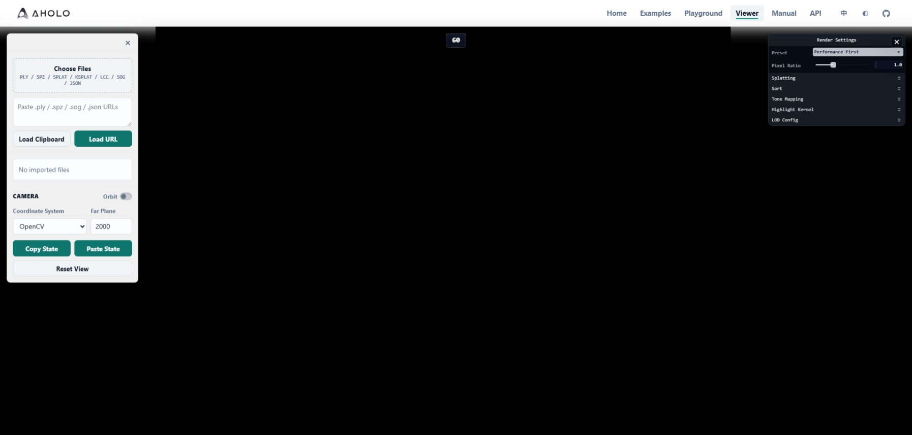

## Overview

[`Viewer`](../../viewer/) is a quick online viewer built with `@manycore/aholo-viewer`. It can import any supported asset and display the result directly. It also supports LOD-format data generated by [`@manycore/aholo-splat-transform`](./splat-transform.md).

> Browsers cannot access local files directly. For `chunk-lod` data, host the files with a server or `CDN`. You can use `@manycore/aholo-splat-dev-server` for quick local hosting.



## Usage Guide

- The left panel imports supported data formats and configures the camera.
    > It supports local files, URLs, and clipboard data (URLs). Local data only supports a complete single asset and does not support `chunk-lod` data.
    >
    > The camera provides 3 world-up presets: OpenCV (-Y up), OpenGL (+Y up), and Aholo (+Z up). Switching presets resets the camera view; it does not transform imported model coordinates.
- The right panel controls `3DGS` features and pipeline configuration. See [`3dgs-preset-config`](./3dgs-preset-config.md).

### Copy Camera Pose

After loading a file, click **Copy pose** at the top left of the canvas to copy the current camera-to-world pose as JSON. A green notification confirms success; a red notification indicates that no file is loaded. The notification fades over 3 seconds and can be dismissed with its close button. Repeated clicks refresh the same notification. If the browser denies clipboard access, the viewer displays an error.

```json
{
    "type": "camera-pose",
    "convention": "camera-to-world",
    "coordinateSystem": "opencv",
    "worldUpPreset": "opencv",
    "cameraAxes": { "right": "+X", "up": "+Y", "forward": "-Z" },
    "position": { "x": 0, "y": 0, "z": 0 },
    "quaternion": { "x": 0, "y": 0, "z": 0, "w": 1 }
}
```

`position` and `quaternion` copy the current rendering camera's values unchanged. The quaternion uses `x, y, z, w` order and rotates camera-local coordinates into the scene's world coordinates. The camera-local axes are always right `+X`, up `+Y`, and forward `-Z`.

`worldUpPreset` records the selected `opencv`, `opengl`, or `aholo` world-up preset. `coordinateSystem` remains as a legacy alias with the same value; it does not specify camera axes. Selecting `opencv` does not export the native OpenCV camera basis (right `+X`, down `+Y`, forward `+Z`). Export does not transform camera or model coordinates and does not include camera intrinsics.

The sidebar's **Copy State** and **Paste State** actions still use the complete browsing state, including Euler angles, up direction, field of view, and clipping planes. They do not use this pose format.

## Local Quick Validation Platform

### Install Dependencies

```bash
npm install @manycore/aholo-splat-transform -g
npm install @manycore/aholo-splat-dev-server -g
```

### Usage

For the full `@manycore/aholo-splat-transform` guide, see [splat-transform](./splat-transform.md).

### `@manycore/aholo-splat-dev-server`

`@manycore/aholo-splat-dev-server` provides two executable commands. `splat-dev-server` starts a local hosting service for assets used by `Viewer`. `merge-lod` merges multiple `lod-meta.json` files and their related assets into one new `lod-meta.json`, which is useful for combining chunked processing results back into one large `3DGS` `chunk-lod` dataset.

- `splat-dev-server`: starts a server for quickly hosting assets used by `Viewer`.
    > ```bash
    > splat-dev-server [options] <dir>
    > Options:
    >    --help     Show help                                             [boolean]
    >    --version  Show version number                                   [boolean]
    > -a, --address  Address to listen               [string] [default: "127.0.0.1"]
    > -p, --port     Port to listen                         [number] [default: 3000]
    > ```
    >
    > After startup, you should see output like this:
    >
    > ```bash
    > ========================================
    > Splat dev server started
    > Host: 127.0.0.1:3000
    > Root: ./chunk-lod
    > Base URL: http://127.0.0.1:3000
    > ========================================
    > ```
    >
    > Access resources under `Root` through the `Base URL`, then enter that URL into the corresponding `Viewer` field.
    >
    > **Note: When used in `Viewer`, the browser may ask for permission. Allow the request. `Viewer` does not access unhosted resources or collect any user information.**
- `merge-lod`: merges multiple `chunk-lod` generation outputs into one result. It is usually used after generating `chunk-lod` in separate chunks and then merging them into a complete large `chunk-lod` dataset.
    > ```bash
    > merge-lod -i <meta-files...> -o <output_dir>
    >
    > Options:
    >      --help     Show help                                             [boolean]
    >      --version  Show version number                                   [boolean]
    >  -i, --input    Input lod meta files(lod-meta.json)          [array] [required]
    >  -o, --output   Output directory                            [string] [required]
    > ```
