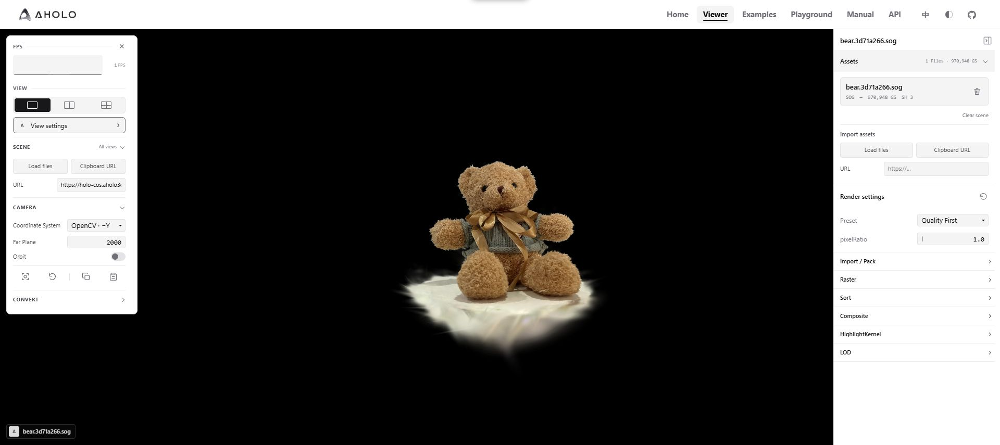
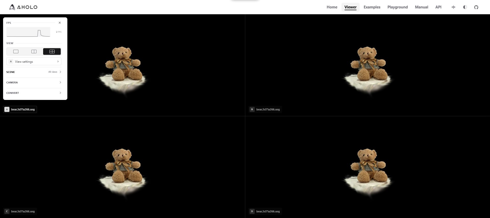

## Interface

[`Viewer`](../../viewer/) is an online viewer built with `@manycore/aholo-viewer`. Use it to inspect 3DGS, GLTF / GLB, and chunked LOD assets, and compare render settings across views.



The screenshot shows Scene, Camera, and Assets expanded. On first load, the left control panel is open and the right inspector is closed.

| Area                          | Purpose and scope                                                                                                                                                                             |
| ----------------------------- | --------------------------------------------------------------------------------------------------------------------------------------------------------------------------------------------- |
| Left controls                 | FPS, view count, Scene, Camera, and Convert. Scene imports replace assets in every created view. Camera tools affect the active view, or other views as well when synchronization is enabled. |
| Canvas                        | Inspect models, move the camera, and drop assets. The bottom-left A–D badge identifies the view; its adjacent name is editable.                                                               |
| Right Assets section          | Manage the active view's resources. The list appears above the append controls. The section starts collapsed.                                                                                 |
| Right Render settings section | The active view's preset and SDK parameters, grouped into Import / Pack, Raster, Sort, Composite, HighlightKernel, and LOD.                                                                   |

Select View settings on the left to open the inspector; its top-right icon collapses it. Opening the inspector does not resize the canvas. Its title follows the active view's name. The reset icon beside Render settings restores all render defaults for that view. Hover over icons and section titles for guidance.

## Quick Start

1. Open View settings and choose a preset. Quality First is the initial preset. Choose `packType` and `maxShDegree` before importing.
2. Click the empty scene to select files, or drop them onto the canvas. Multiple models can be imported together. Include `.bin` and textures with GLTF, or drop the complete folder.
3. An empty scene frames the imported batch when loading finishes. Use Camera → Frame models to frame it again.
4. Adjust the right-hand settings. To compare views, create Split or Quad first, then load the same assets through the left Scene section.

## Import and Manage Assets

### Import Scope

| Entry point                                                     | Target                 | Existing assets                         |
| --------------------------------------------------------------- | ---------------------- | --------------------------------------- |
| Click the empty scene                                           | Active view            | Load the selected batch                 |
| Files, URL, or Clipboard URL in the left Scene section          | All created views      | Replace with the batch                  |
| Files, URL, or Clipboard URL in the right Import assets section | Active view            | Append                                  |
| Drop onto a viewport                                            | View under the pointer | Replace by default; hold Ctrl to append |

Press Enter to confirm a URL. Multiple URLs can be separated by spaces, newlines, or commas. Ctrl changes only drag-and-drop behavior. Changing the view count does not copy models automatically: create the required views before importing through Scene.

### Supported Resources

- **3DGS**: PLY, SPZ, SPLAT, KSPLAT, SOG, ESZ, and LCC / LCC2 ZIP. Regular GS files are parsed in a Worker and uploaded to the GPU in chunks without retaining a complete CPU copy of the encoded data. Models appear after upload, and framing uses the complete batch bounds.
- **GLTF / GLB**: Select or drop companion files with a local GLTF file. URL imports resolve relative resources against the model URL. Materials and extensions depend on the current loader; models are displayed in their static pose.
- **Chunked LOD**: Import `lod-meta.json` by URL. Host the manifest and chunks over HTTP or a CDN. Chunk paths resolve relative to the manifest URL; see the local server instructions below.

The asset list shows format, local file size, and Gaussian count, SH degree, or mesh count. The trash icon removes that resource only. Pending imports can be canceled and failed imports retried. Clear scene removes every asset in the active view. Removing assets or reducing the view count releases the corresponding resources.

## Multiple Views and Comparison



Choose Single, Split, or Quad in the left View section. Render settings are independent for each view. Sync cameras shares only camera state, allowing different settings to be compared with the same framing.

| Action                                          | Result                                                                                                        |
| ----------------------------------------------- | ------------------------------------------------------------------------------------------------------------- |
| Click a viewport or press 1 / 2 / 3 / 4         | Activate an existing A / B / C / D view; shortcuts are inactive while editing fields                          |
| Double-click the canvas                         | Maximize the active view; repeat to restore the split layout and its proportions                              |
| Select A–D at the bottom center while maximized | Switch the displayed view                                                                                     |
| Focus the maximized canvas and hold Space       | Preview the previously active view; release to return. Without a previous selection, use the first other view |
| Double-click the bottom-left name               | Rename the view; save on blur. An empty value restores its automatic name. Names last for the page session    |
| F11                                             | Enter or leave browser fullscreen, hiding or restoring page navigation                                        |
| Esc                                             | Collapse the inspector first, otherwise leave maximized mode; inactive while editing a field                  |

Drag a divider to resize views. Split and Quad retain separate ratios. Quad supports both column widths and row heights; Split stacks vertically on mobile. Each side occupies at least 15%, with snapping near the center. Double-click a divider to restore equal sizes. When a divider has focus, arrow keys adjust by 2%; Home or Enter restores equal sizes.

**The selected layout determines the actual view count.** Quad → Split destroys C and D; Single destroys B–D and releases their models. Recreated views can restore cached render settings, but their models must be imported again. Maximizing a view changes visibility only and preserves the other views.

## Camera

The default coordinate system is OpenCV (−Y up). OpenGL (+Y up) and Aholo (+Z up) are also available. If the first asset imported into an empty scene is GLTF / GLB, Viewer selects OpenGL automatically.

| Input or tool             | Behavior                                                                                              |
| ------------------------- | ----------------------------------------------------------------------------------------------------- |
| Left-drag                 | Look around; with Orbit enabled, rotate around the models' bounding-box center                        |
| Alt + left-drag           | Orbit temporarily                                                                                     |
| Right-drag / middle-drag  | Pan                                                                                                   |
| Mouse wheel               | Move along the viewing direction                                                                      |
| W / S, A / D, Q / E       | Forward/back, left/right, up/down; Shift, Ctrl, and CapsLock increase speed                           |
| R / F                     | Roll                                                                                                  |
| Frame models / Reset View | Fit the models in the viewport, or restore the coordinate system's initial view                       |
| Copy State / Paste State  | Save and restore camera position, orientation, clipping planes, and other state through the clipboard |

Enabling Orbit preserves the current position, orientation, and framing. The first drag does not snap the camera toward the bounds center. Use Frame models when you want to aim at the models explicitly.

## Render Settings, Presets, and Cache

The five presets are **Max Quality, Quality First, Balanced, Performance First, and Extreme Performance**. Without a valid cache, Quality First is selected with Compressed packing and SH 3. Shared defaults include `pixelRatio = 1`, `repackEnabled = true`, `radial = false`, a 6-million LOD budget, and 8 parallel tasks.

Switching presets updates **12 preset parameters** and preserves **25 shared parameters**, including pixelRatio, Repack, Radial, blur, sorting thresholds, tone mapping, exposure, HighlightKernel, and LOD. Editing a preset parameter selects Custom; editing a shared parameter retains the preset. See [3DGS preset configuration](./3dgs-preset-config.md) for values and SDK mappings.

Labels use SDK field names. Numeric controls support typing and dragging; `maxShDegree` is limited to 0–3. `packType` and `maxShDegree` take effect on the next import and do not reparse loaded resources. Other render settings apply to the current view. The panel displays `maxStdDev` as 5–8; Viewer passes its square root to the SDK.

Settings are saved per A–D view in the current browser and restored after reload. Cache version is `v1`; missing or mismatched versions use defaults. The reset icon restores both preset and shared parameters. Models, cameras, and custom view names are not included in this cache. Valid saved settings take precedence over new defaults.

The FPS graph measures the whole viewer, including visible views. Collapsing the controls leaves a numeric FPS button in the upper-left corner. A lost graphics context displays an interruption message; reload the page and import resources again.

## Format Conversion

Expand Convert, select one or more 3DGS files, choose PLY, SPZ, or SPLAT, then select Convert and download. Multiple inputs are merged into one output. Conversion runs in the browser and can be canceled. GLTF / GLB and chunked LOD manifests cannot be converted into a single 3DGS file. Use [splat-transform](./splat-transform.md) for large batch jobs.

## Local LOD Server

After generating chunks with [`splat-transform`](./splat-transform.md), serve the complete output directory:

```bash
npm install -g @manycore/aholo-splat-dev-server
splat-dev-server ./chunk-lod --address 127.0.0.1 --port 3000
```

Enter `http://127.0.0.1:3000/lod-meta.json` in Viewer and press Enter. Keep the server running so camera movements can trigger further chunk loads. If the browser requests local network access, allow it to load the resources.

Merge separately generated outputs before serving the combined directory:

```bash
merge-lod -i ./part-a/lod-meta.json ./part-b/lod-meta.json -o ./merged-lod
splat-dev-server ./merged-lod
```

See [Chunk LOD](./chunk-lod.md) for the data format and scheduling options.
