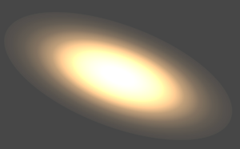
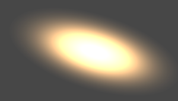

## 背景

单一配置无法覆盖所有 3DGS 场景。不同场景在数据精度、体积、显存、机器性能和画质要求上差异较大，因此需要按业务目标选择合理的配置组合。

这篇文档整理常见数据格式、`packType` 差异、preset 列表，以及可在 preset 基础上继续微调的参数。

## 快速选择

先按业务约束选择 preset，再只微调最关键的参数。不要一开始就同时调整多个精度、排序和模糊参数。

| 场景目标                                 | 建议起点   | 需要关注                                                                                                 |
| ---------------------------------------- | ---------- | -------------------------------------------------------------------------------------------------------- |
| 画质优先，用户设备性能强                 | 极限效果   | `compressed`、`pack.highPrecisionEnabled`、`composite.highPrecisionEnabled`、`sort.highPrecisionEnabled` |
| 大场景且低精度容易出问题                 | 效果优先   | `compressed`、`pack.highPrecisionEnabled`                                                                |
| 设备较弱但需要打开大规模方案             | 均衡       | `super-compressed`、`cameraRelativeEnabled`                                                              |
| 设备较弱但仍需要较完整画面               | 性能优先   | `super-compressed`、`raster.detailCullingThreshold`、`raster.maxPixelRadius`                             |
| 极大场景或极低设备配置                   | 极限性能 0 | `maxShDegree: 0`、`sort.minIntervalMs`、更激进的精度压缩                                                 |
| 原始数据为 sog，且目标是打开更大规模场景 | 极限性能 1 | `sog`、`pack.precalculateEnabled`、显存占用                                                              |

## 3DGS 文件格式

| 数据格式         | 体积               | 渲染质量       | 实现细节                                                                                                                                                                          |
| ---------------- | ------------------ | -------------- | --------------------------------------------------------------------------------------------------------------------------------------------------------------------------------- |
| `ply`            | 100%               | 好             | 原始精度高，体积最大。                                                                                                                                                            |
| `compressed ply` | 30%，gzip 后约 17% | 较好           | 以 256 个 splat 为 chunk，大概率与 ksplat 类似按空间划分。`center`、`quat`、`scale`、`rgb` 会计算 min/max，并通过 rescale 与量化压缩。SH 可压缩到 u8，实测中约为 5 bit。          |
| `spz`            | 10%                | 一般           | 对 splat 核心数据，尤其是 `center`，精度保留较高，因此锐利度损失较低；SH 精度很低，细微场景容易出现明显变色。                                                                     |
| `splat`          | 14%                | 一般，不通用   | 压缩时删除 `shN` 数据。数据排布为 `center.xyz (f32)`、`scale.xyz (f32)`、`color.rgba (u8)`、`quat (u8)`，共 32 字节。                                                             |
| `ksplat`         | 20%-30%            | 依赖压缩 level | level 0 不压缩，level 1 为 16 bit，level 2 为 8 bit。会按空间聚类进行局部坐标压缩，整体思路与 compressed 类似。                                                                   |
| `sog`            | 5%                 | 一般           | 对 `center`、`scales`、`quats`、`sh0(rgba)` 做 PLAS 排序，再计算 min/max 并量化。`shN` 会做 k-means 聚类，用 centroids 和 labels 恢复数据，以提高精度并减少体积。画面会相对模糊。 |

### compressed ply 量化示意


## packType

`packType` 控制解析 splats 时生成的数据精度。不同配置会在体积、质量和性能之间做取舍。

### Compressed

| 字段            | 精度         |
| --------------- | ------------ |
| `position`      | `f32 (3)`    |
| `scale`         | `f16 (3)`    |
| `quat`          | `f16 (4)`    |
| `color & alpha` | `f16 (4)`    |
| `shN`           | `s_11_10_11` |

`Compressed` 更偏向画质与数据精度，适合质量要求高、场景尺寸较大或低精度下容易出现异常的场景。

### SuperCompressed

| 字段            | 精度                                  |
| --------------- | ------------------------------------- |
| `position`      | `f16 (3)`                             |
| `scale`         | `u8 (3)`                              |
| `quat`          | `u8 (4)`                              |
| `color & alpha` | `u8 (4)`                              |
| `shN`           | `sh1 (sint5)`，`sh2` 和 `sh3 (sint4)` |

`SuperCompressed` 更偏向体积、内存和显存控制。它适合资源紧张、设备配置较低或性能优先的场景。

### Sog

`Sog` 面向 sog 数据格式。它的体积最小，但画面可能更模糊。原始格式为 sog，且没有 `shN` 或对极限场景规模有要求时，可以优先考虑。

## Preset List

| 预设名     | 适用场景                                                                                                    |
| ---------- | ----------------------------------------------------------------------------------------------------------- |
| 极限效果   | 对效果有最高要求，设备性能很强。                                                                            |
| 效果优先   | 对效果有一定要求，设备性能尚可。                                                                            |
| 均衡       | 对效果要求低，设备性能较低，但需要支持大场景。                                                              |
| 性能优先   | 对效果要求低，设备性能较低。                                                                                |
| 极限性能 0 | 机器配置极低，或场景规模极大时。                                                                            |
| 极限性能 1 | 机器配置极低或场景规模极大，并且原始数据格式为 sog 时。满足条件时更建议使用这个配置，可打开更大的场景规模。 |

### 极限效果

```typescript
// set parser config
const splatData = await SplatLoader.parseSplatData(
    // file type and data
    splatFileType,
    content,
    // compress config
    SplatLoader.SplatPackType.Compressed,
);
const splat = await SplatUtils.createSplat(splatData);
splat.autoFreeResourceOnGpuPacked = true;
viewer.getScene().add(splat);

// update viewer config
setViewerConfig(viewer, {
    pipeline: {
        Splatting: {
            pack: {
                highPrecisionEnabled: true,
                cameraRelativeEnabled: false,
            },
            raster: {
                normalizedFalloff: true,
                detailCullingThreshold: 0,
            },
            sort: {
                highPrecisionEnabled: true,
            },
            composite: {
                enabled: true,
                highPrecisionEnabled: true,
            },
        },
    },
});
```


### 效果优先

```typescript
// set parser config
const splatData = await SplatLoader.parseSplatData(
    // file type and data
    splatFileType,
    content,
    // compress config
    SplatLoader.SplatPackType.Compressed,
);
const splat = await SplatUtils.createSplat(splatData);
splat.autoFreeResourceOnGpuPacked = true;
viewer.getScene().add(splat);

// update viewer config
setViewerConfig(viewer, {
    pipeline: {
        Splatting: {
            pack: {
                highPrecisionEnabled: true,
                cameraRelativeEnabled: false,
            },
        },
    },
});
```


### 均衡

```typescript
// set parser config
const splatData = await SplatLoader.parseSplatData(
    // file type and data
    splatFileType,
    content,
    // compress config
    SplatLoader.SplatPackType.SuperCompressed,
);
const splat = await SplatUtils.createSplat(splatData);
viewer.getScene().add(splat);

// update viewer config
setViewerConfig(viewer, {
    pipeline: {
        Splatting: {},
    },
});
```

### 性能优先

```typescript
// set parser config
const splatData = await SplatLoader.parseSplatData(
    // file type and data
    splatFileType,
    content,
    // compress config
    SplatLoader.SplatPackType.SuperCompressed,
);
const splat = await SplatUtils.createSplat(splatData);
splat.autoFreeResourceOnGpuPacked = true;
viewer.getScene().add(splat);

// update viewer config
setViewerConfig(viewer, {
    pipeline: {
        Splatting: {
            pack: {
                cameraRelativeEnabled: false,
            },
            raster: {
                maxStdDev: Math.sqrt(5),
            },
        },
    },
});
```


### 极限性能 0

```typescript
// set parser config
const splatData = await SplatLoader.parseSplatData(
    // file type and data
    splatFileType,
    content,
    // compress config & sh
    SplatLoader.SplatPackType.SuperCompressed,
    {
        maxShDegree: 0,
    },
);
const splat = await SplatUtils.createSplat(splatData);
splat.autoFreeResourceOnGpuPacked = true;
viewer.getScene().add(splat);

// update viewer config
setViewerConfig(viewer, {
    pipeline: {
        Splatting: {
            pack: {
                precalculateEnabled: false,
                cameraRelativeEnabled: false,
            },
            raster: {
                detailCullingThreshold: 4,
                maxStdDev: Math.sqrt(5),
            },
            sort: {
                minIntervalMs: 160,
            },
        },
    },
});
```


### 极限性能 1

```typescript
// set parser config
const splatData = await SplatLoader.parseSplatData(
    // file type and data
    SplatLoader.SplatFileType.SOG,
    content,
    // compress config & sh
    SplatLoader.SplatPackType.Sog,
    {
        maxShDegree: 0,
    },
);
const splat = await SplatUtils.createSplat(splatData);
splat.autoFreeResourceOnGpuPacked = true;
viewer.getScene().add(splat);

// update viewer config
setViewerConfig(viewer, {
    pipeline: {
        Splatting: {
            pack: {
                precalculateEnabled: false,
                cameraRelativeEnabled: false,
            },
            raster: {
                detailCullingThreshold: 4,
                maxStdDev: Math.sqrt(5),
            },
            sort: {
                minIntervalMs: 160,
            },
        },
    },
});
```


## 定制化配置

Preset 无法覆盖所有场景。实际接入时可以选择最接近目标的 preset 作为起点，再调整少量关键参数。
参数可以通过[config](./config.md)接口进行调整，示例如下

```typescript
setViewerConfig(viewer, {
    pipeline: {
        Splatting: {
            // ... options..
        },
    },
});
```

| 参数名                                         | 作用                         | 建议                                                                                                                                                                                                                                                  |
| ---------------------------------------------- | ---------------------------- | ----------------------------------------------------------------------------------------------------------------------------------------------------------------------------------------------------------------------------------------------------- |
| `pack.highPrecisionEnabled`                    | 是否开启高精度数据合并。     | 决定最终用于渲染的数据精度。`compressed` 下通常需要开启；`sog` 下需要看具体场景。                                                                                                                                                                     |
| `pack.precalculateEnabled`                     | 是否预计算球谐颜色。         | 根据观察方向计算 SH 颜色贡献；没有高阶 SH 数据时不会产生视角相关颜色。                                                                                                                                                                                |
| `pack.cameraRelativeEnabled`                   | 是否开启相机相对位置计算。   | 如果center值较大，但设备性能不足以支持`highPrecisionEnabled`的启用，可以尝试开启，但需注意开启后会在gpu上按需pack数据，应该关掉autoFreeResourceOnGpuPacked防止贴图数据的重复上传，但如果是lod数据那由于实现本身就需要反复pack数据则可以免费做这件事。 |
| `composite.enabled`                            | 开启离屏合成与色调映射。     | 默认关闭。使用曲线、曝光或高精度中间缓冲前需开启。                                                                                                                                                                                                    |
| `composite.toneMapping` / `composite.exposure` | 控制色调映射曲线与曝光。     | 默认 `ToneMapping.Linear` 和 `1`。原 `Splatting.toneMapping` 配置迁移到此处，详见[配置迁移](./config.md)。                                                                                                                                            |
| `composite.highPrecisionEnabled`               | 是否开启高精度渲染缓冲。     | 场景中出现水波扩散状条纹时可以考虑开启；对效果要求较高时也可开启；会增加显存开销。                                                                                                                                                                    |
| `raster.normalizedFalloff`                     | 开启高斯函数结果归一化曲线。 | 大多数场景差异不明显。除非追求最佳效果，否则不建议开启。                                                                                                                                                                                              |
| `raster.preBlurAmount` / `raster.blurAmount`   | 控制模糊参数。               | 非 AA 训练结果通常使用 `0.3 / 0`；AA 训练结果通常使用 `0 / 0.3`。不建议设置其他值。                                                                                                                                                                   |
| `raster.focalAdjustment`                       | 调整 splat 扩散缩放。        | 设置为 `2` 更接近参考结果。                                                                                                                                                                                                                           |
| `raster.detailCullingThreshold`                | 近似细节剔除。               | 通常值在 `[0, 4]`。一般设置 `1` 对画面损失极小，具体性能收益取决于方案精细程度。                                                                                                                                                                      |
| `raster.maxPixelRadius`                        | 高斯覆盖屏幕的最大像素范围。 | 默认 `1024`，建议在 `[128, 1024]` 之间。过小可能导致方案破碎。                                                                                                                                                                                        |
| `raster.maxStdDev`                             | 高斯扩散的最大标准差。       | 范围应在 `sqrt(5)` 到 `sqrt(9)`。值越大性能越差，但效果越好；`sqrt(8)` 通常是效果和性能之间的折中点。                                                                                                                                                 |
| `sort.highPrecisionEnabled`                    | 设置排序精度。               | 开启后用 float 进行排序，绝大多数渲染场景下对于效果的提升较小。                                                                                                                                                                                       |
| `sort.minIntervalMs`                           | 设置排序最小发生间隔。       | 增大可降低排序频率，但快速移动时排序更新会滞后。可从 `16 * n` ms 开始评估，`n` 通常不大于 `10`；默认 `0`。                                                                                                                                            |

### 逐高斯禁用 SH

[`SplatState.DisableSH`](api:SplatState) 可关闭指定高斯的视角相关 SH 颜色贡献，并保留基础色。使用与 `splat` 对应的解析数据创建 [`SplatUtils.SplatOperator`](api:SplatUtils.SplatOperator)，再设置状态位：

```typescript
import { SplatState, SplatUtils } from '@manycore/aholo-viewer';

const operator = new SplatUtils.SplatOperator(splat, splatData);
operator.setState([0], SplatState.DisableSH);
viewer.render();
```

`[0]` 表示第一个高斯的索引。调用 `operator.setState([0], SplatState.DisableSH, true)` 可移除此状态位并恢复 SH 颜色，之后重新渲染。该操作不会删除已加载的 SH 数据，也不会改变其他高斯的状态；`pack.precalculateEnabled` 仍控制整体 SH 预计算。

### normalizedFalloff 对比



