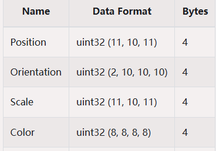

## 选择预设

[Viewer](./viewer.md) 默认使用**效果优先**。当前提供五档预设，极限性能只有一档。先确定设备与场景目标，再以一档作为调整起点；不同数据的画质和性能需要在目标设备上验证。

| 预设             | 配置特点                                                          |
| ---------------- | ----------------------------------------------------------------- |
| 极限效果         | Compressed、SH 3、高精度合并，并开启离屏合成和高精度合成缓冲      |
| 效果优先（默认） | 保留 Compressed、SH 3 与高精度合并，关闭离屏合成                  |
| 均衡模式         | SuperCompressed、SH 3，启用相机相对坐标，并保留源资源供后续合并   |
| 性能优先         | SuperCompressed、SH 3，缩小高斯截断范围，细节剔除计入透明度       |
| 极限性能         | SuperCompressed、SH 0，关闭 SH 预计算，提高剔除阈值并降低排序频率 |

## 档位参数

切换预设只更新以下 **12 项**。`packType`、`maxShDegree` 是解析选项，`splat.autoFreeResourceOnGpuPacked` 是对象属性；`pack`、`raster`、`sort`、`composite` 均位于 `pipeline.Splatting`。表内名称补充分组前缀，以区分面板中重复的 `enabled`、`highPrecisionEnabled`。

| 参数                                | 极限效果   | 效果优先   | 均衡模式        | 性能优先        | 极限性能        |
| ----------------------------------- | ---------- | ---------- | --------------- | --------------- | --------------- |
| `packType`                          | Compressed | Compressed | SuperCompressed | SuperCompressed | SuperCompressed |
| `maxShDegree`                       | 3          | 3          | 3               | 3               | 0               |
| `pack.highPrecisionEnabled`         | true       | true       | false           | false           | false           |
| `pack.precalculateEnabled`          | true       | true       | true            | true            | false           |
| `pack.cameraRelativeEnabled`        | false      | false      | true            | false           | false           |
| `splat.autoFreeResourceOnGpuPacked` | true       | true       | false           | true            | true            |
| `raster.detailCullingThreshold`     | 1          | 1          | 1               | 1               | 4               |
| `raster.detailCullingAlphaEnabled`  | false      | false      | false           | true            | true            |
| `raster.maxStdDev`                  | 8          | 8          | 8               | 5               | 5               |
| `sort.minIntervalMs`                | 0          | 0          | 0               | 0               | 160             |
| `composite.enabled`                 | true       | false      | false           | false           | false           |
| `composite.highPrecisionEnabled`    | true       | false      | false           | false           | false           |

表中的 `raster.maxStdDev` 使用 **Viewer 面板值**：8 和 5 传入 SDK 时分别为 `Math.sqrt(8)` 和 `Math.sqrt(5)`。`sort.minIntervalMs` 的单位为毫秒。极限效果与效果优先的 `detailCullingThreshold` 都是 1；性能优先和极限性能都开启 `detailCullingAlphaEnabled`。

## 统一参数

以下 **25 项**不随预设切换变化。修改它们仍保留当前档位；修改上表中的档位参数才会显示“自定义”。选择“自定义”本身不改动数值。重置图标恢复效果优先和全部统一默认值。

| 参数                             | Viewer 默认值 |
| -------------------------------- | ------------- |
| `pixelRatio`                     | 1             |
| `pack.repackEnabled`             | true          |
| `raster.preBlurAmount`           | 0.3           |
| `raster.blurAmount`              | 0             |
| `raster.focalAdjustment`         | 2             |
| `raster.maxPixelRadius`          | 1024          |
| `sort.radial`                    | false         |
| `sort.sortSplatDistance`         | 0.1           |
| `sort.sortSplatCoorient`         | 0.99999       |
| `sort.sortCameraDistance`        | 1             |
| `sort.sortCameraCoorient`        | 0.99          |
| `composite.toneMapping`          | Linear        |
| `composite.exposure`             | 1             |
| `highlightKernel.enabled`        | false         |
| `highlightKernel.size`           | 2             |
| `highlightKernel.color`          | #0000ff       |
| `LOD.minLevel`                   | 0             |
| `LOD.movingMinLevel`             | 2             |
| `LOD.maxBudget`                  | 6000000       |
| `LOD.pixelLimitEnabled`          | true          |
| `LOD.frustumCullingEnabled`      | true          |
| `LOD.hysteresisTicks`            | 4             |
| `LOD.schedulerParallelCounts`    | 8             |
| `LOD.schedulerExistingTaskLimit` | 64            |
| `LOD.schedulerMinDuration`       | 160           |

这些是 **Viewer 的默认值**，不代表 SDK 的全局默认值。特别是 Viewer 默认开启 `pack.repackEnabled`，关闭 `sort.radial`。面板 `pixelRatio` 表示实际渲染倍率；Viewer 传入 SDK 的值为 `pixelRatio / window.devicePixelRatio`。`highlightKernel.color` 在面板中用十六进制颜色表示，传入 SDK 时转换为数字。`LOD.*` 对应 `LodSplat.setConfig()` 的字段，不属于 `pipeline.Splatting`。

## 生效时机与缓存

- **导入时**：`packType` 和 `maxShDegree` 只影响后续解析，已加载资源不会自动重新打包。对比档位时，先给各视图选择预设，再统一导入相同资源。
- **渲染时**：其余渲染设置应用到当前视图；`autoFreeResourceOnGpuPacked` 应用于普通 Splat 对象，LOD 配置交给 LOD 调度器。已有资源包含 SH 0 时，应用预设或恢复默认会保持 `precalculateEnabled = false`。
- **恢复时**：各视图的参数按 `v1` 缓存到当前浏览器；版本缺失或不匹配时直接采用默认值。切预设保留统一参数，恢复默认则重置两者。文件本身不进入配置缓存。

上述解析选项用于普通 GS 文件。当前 Viewer 的分块 LOD 路径固定使用 Compressed 解析分块，SH 内容由生成的 LOD 数据决定；面板中的 `packType`、`maxShDegree` 不会重新编码 LOD 数据。

## 文件格式与 packType

源文件格式决定存储与传输编码；`packType` 决定解析后的运行时数据布局。二者不是同一层配置：例如 SOG 文件也可以解析成 Compressed 或 SuperCompressed。改变 `packType` 不会恢复源文件已丢失的精度或 SH。

| 源文件               | 使用说明                                              |
| -------------------- | ----------------------------------------------------- |
| PLY / compressed PLY | 支持常见高斯 PLY 和压缩 PLY；精度与体积取决于导出编码 |
| SPZ / KSPLAT         | 压缩高斯格式；SH 和量化信息以文件实际内容为准         |
| SPLAT                | 32 字节基础高斯记录，不包含高阶 SH                    |
| SOG                  | 图像编码格式，可使用 Sog 运行时布局，也可转为其他布局 |
| ESZ / LCC / LCC2     | 使用加载器支持的对应格式；LCC / LCC2 以 ZIP 导入      |

下图仅展示 **compressed PLY 文件编码**，不代表 Compressed GPU 布局。



| packType                                    | 说明                                                                   |
| ------------------------------------------- | ---------------------------------------------------------------------- |
| `SplatLoader.SplatPackType.Compressed`      | 位置保留 f32；适合需要较高坐标精度的场景。效果优先和极限效果使用此布局 |
| `SplatLoader.SplatPackType.SuperCompressed` | 使用更紧凑的量化布局；均衡模式、性能优先和极限性能使用此布局           |
| `SplatLoader.SplatPackType.Sog`             | 直接使用 SOG 编码，仅支持 SOG 源文件；可手动选择，但不属于当前五档预设 |

自定义 Compressed / SuperCompressed sampler 数据或 `maxTextureSize` 时，源纹理宽度必须是 2 的幂。默认解析配置满足此约束。

## 在 SDK 中使用效果优先

以下示例对应效果优先的 12 项专属参数。`viewer` 是已创建并设置场景、相机的 Viewer，`modelUrl` 是 PLY URL。统一参数由应用单独管理；这里只更新档位相关字段，不覆盖已有统一设置。示例使用公开的常规解析接口，Viewer 页面中的 GPU 分块上传由页面宿主负责。

```typescript
import { SplatLoader, SplatUtils, setViewerConfig } from '@manycore/aholo-viewer';

const data = await SplatLoader.parseSplatData(
    SplatLoader.SplatFileType.PLY,
    modelUrl,
    SplatLoader.SplatPackType.Compressed,
    { maxShDegree: 3 },
);
const splat = await SplatUtils.createSplat(data);
splat.autoFreeResourceOnGpuPacked = true;
viewer.getScene().add(splat);

setViewerConfig(viewer, {
    pipeline: {
        Splatting: {
            pack: {
                highPrecisionEnabled: true,
                precalculateEnabled: true,
                cameraRelativeEnabled: false,
            },
            raster: {
                detailCullingThreshold: 1,
                detailCullingAlphaEnabled: false,
                maxStdDev: Math.sqrt(8),
            },
            sort: { minIntervalMs: 0 },
            composite: {
                enabled: false,
                highPrecisionEnabled: false,
            },
        },
    },
});
viewer.render();
```

`maxShDegree: 3` 是上限，不会为原本没有 SH 的资源生成 SH。其他档位按上表替换解析选项、对象属性和对应管线字段即可。`setViewerConfig` 的完整结构见[配置](./config.md)。

## 调整时关注的关系

| 参数                                                          | 关注点                                                                 |
| ------------------------------------------------------------- | ---------------------------------------------------------------------- |
| `pack.cameraRelativeEnabled` / `autoFreeResourceOnGpuPacked`  | 相机相对坐标需要随相机变化重新合并数据；均衡模式因此关闭自动释放源资源 |
| `pack.repackEnabled`                                          | 按排序结果重排 WebGL 纹理，需要额外显存和处理；应在目标场景上测量收益  |
| `raster.detailCullingThreshold` / `detailCullingAlphaEnabled` | 共同控制细节剔除，开启透明度参与后低透明度高斯更容易被剔除             |
| `raster.preBlurAmount` / `blurAmount`                         | 根据训练是否采用抗锯齿配置评估；常见组合为 0.3 / 0 或 0 / 0.3          |
| `sort.minIntervalMs`                                          | 增大可减少排序频率，但相机快速移动时更新更滞后                         |
| `sort.radial`                                                 | 改为相机距离排序，会改变透明混合顺序                                   |
| `composite.enabled` / `toneMapping` / `exposure`              | 色调映射和曝光需要先开启离屏合成；切换档位保留曲线与曝光值             |

旧的 `sortedLayoutEnabled`、`normalizedFalloff`、`sort.highPrecisionEnabled` 不应再放入预设，迁移说明见[配置](./config.md)。

### 逐高斯禁用 SH

[`SplatState.DisableSH`](api:SplatState) 可关闭指定高斯的视角相关 SH 贡献并保留基础色。使用与 `splat` 对应、保留 CPU 数据的解析结果创建 [`SplatUtils.SplatOperator`](api:SplatUtils.SplatOperator)：

```typescript
import { SplatState, SplatUtils } from '@manycore/aholo-viewer';

const operator = new SplatUtils.SplatOperator(splat, data);
operator.setState([0], SplatState.DisableSH);
viewer.render();
```

`[0]` 是第一个高斯的索引。调用 `operator.setState([0], SplatState.DisableSH, true)` 可移除此状态位，随后重新渲染。操作不删除已加载的 SH 数据，不改变其他高斯的状态；`pack.precalculateEnabled` 仍控制整体 SH 预计算。
