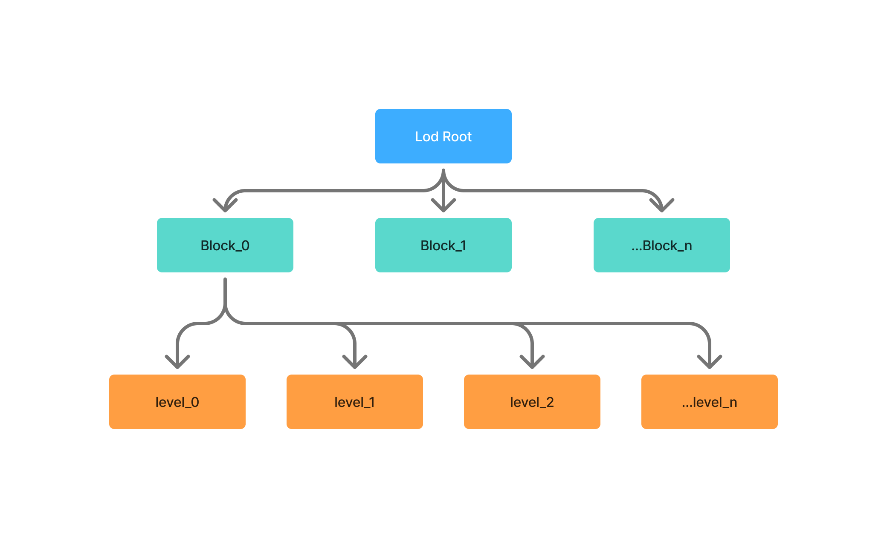

## 背景

`3DGS`目前在渲染大规模场景的情况下，需要的系统资源远超目前常规设备硬件规格，导致大规模`3DGS`基本不可能在常规设备上渲染，因此需要采用`stream+lod`的形式通过放弃不重要部分的细节提升视觉中心的质量以达到以较少系统资源需求展示大规模场景的目标。`@manycore/aholo-viewer`采用了分块+lod的`chunk-lod`的实现作为主要`lod`实现。`lod`生成采用了不需要依赖训练的后处理融合高斯的实现。



## `chunk-lod`生成

`@manycore/aholo-viewer`使用的`chunk-lod`数据主要可以通过[`@manycore/aholo-splat-transform`](./splat-transform.md)生成，推荐使用 `esz` 输出。生成主要经过以下几个步骤：

1. 块分割
    > 块分割主要采用八叉树，`maxChunkCounts` 默认以 `400000` 个高斯控制初始分块规模。大型方案可以增加该值以减少块数；合并后的层级文件可能超过此规模。
2. 高斯查找和融合
    > 在每个块内，每级别的`lod`使用上一级别的结果生成，每个级别通过循环查找和合并使其达到目标数量。
    >
    > 对于保留数量较少的级别，会进一步对高斯进行放大处理以减少级别保留数量过少导致的空洞。
    >
    > 我们在融合后还会进行进一步的`opacity`剔除，减少可见性较差的高斯。
    >
    > 同时当高斯数量少于一定数量时，我们会不再进行进一步的融合，虽然此时会导致输出数量略多于目标数量，但是整体偏差很小，但是能减少最终输出的块整体还是值得的。
    >
    > 为了防止无法正常产出结果，我们会设定每个级别的最大迭代次数，当触及最大迭代次数时，即使未达到目标数量，我们依旧会直接跳出。
3. 输出处理
    > 默认将目标比例为 `5%` 和 `1%` 的粗层级设置为 `merged: true`、`permanent: true`，合并各层尚未安排输出的块，并将引用文件标记为常驻。自定义 `levels` 会替换整个默认数组，省略这两个字段时均为 `false`。最终输出 `lod-meta.json` 描述各块的文件区间；完整参数见 [AutoChunkLod](./splat-transform.md#autochunklod)。

参考资料：

- [A Hierarchical 3D Gaussian Representation for Real-Time Rendering of Very Large Datasets](https://repo-sam.inria.fr/fungraph/hierarchical-3d-gaussians/)
- [NanoGS: Training-Free Gaussian Splat Simplification](https://saliteta.github.io/NanoGS/)

## `lod-meta.json`格式说明

```typescript
interface IBox {
    min: [number, number, number];
    max: [number, number, number];
}

// typings for
interface LodMeta {
    magicCode: 2500660;
    type: 'lod-splat';
    version: string;
    counts: number;
    shDegree: number;
    levels: number;
    files: string[];
    voxels?: string[];
    forwardBox: IBox;
    permanentFiles: number[];
    tree: Array<{
        bound: IBox;
        lods: Array<{
            file: number;
            offset: number;
            count: number;
        }>;
    }>;
}
```

- `counts`: `level 0`总高斯数量
- `shDegree`: 球协阶数
- `forwardBox`: `level 0`所有高斯中约`80%`高斯球体所在的空间的包围盒。
- `files`: 文件列表
- `voxels`: 可选的体素描述文件列表，路径相对于当前 `lod-meta.json` 所在目录，例如 `["../voxel/voxel-meta.json"]`。同一 pipeline 对相同输入或其简化、提取后的模型成功生成体素时自动写入；支持多个体素输出，重复路径只保留一份。`Voxel` 可以位于 LOD 的 `Write` 前或后，没有关联体素输出时省略此字段。
- `permanentFiles`: 需要内存/显存持久化的文件索引
- `tree`: `lod`的分块树
    - `tree[i].bound`: 分块的包围盒，此包围盒同样采用近似的分布计算，排除离群点
    - `tree[i].lods`: 分块的lod数据
        - `tree[i].lods[j].file`: 数据文件索引
        - `tree[i].lods[j].offset`: 起始高斯偏移
        - `tree[i].lods[j].count`: 高斯数量

## `LodSplat` 调度器

`@manycore/aholo-viewer` 通过 [`SplatUtils.LodSplat`](api:SplatUtils.LodSplat) 提供流式调度。完整示例见 [Splatting LOD 流式加载](../../examples/splatting-lod-stream/)。

调度器先保证可见分块的粗粒度覆盖，再依据屏幕投影面积、与画面中心的关系和剩余点数预算分配细节。`level 0` 最精细，数值越大越粗。相机移动时限制新的细化，停稳后继续提升细节；已经显示的精细层级不会仅因移动限制而被降级。

### 配置

构造函数的第二个参数和 `setConfig()` 都接受 `Partial<SplatUtils.LodConfig>`。下表为 SDK 默认值；流式示例将 `maxBudget` 设为 `6_000_000`，面板以百万点为单位显示。

| 参数                         | 默认值      | 说明                                                                                                    |
| ---------------------------- | ----------- | ------------------------------------------------------------------------------------------------------- |
| `minLevel`                   | `0`         | 允许选择的最精细层级。                                                                                  |
| `movingMinLevel`             | `2`         | 相机移动时允许新细化到的最精细层级，实际下限取 `max(minLevel, movingMinLevel)`。                        |
| `maxBudget`                  | `3_000_000` | LOD 目标高斯点数预算。                                                                                  |
| `pixelLimitEnabled`          | `true`      | 达到每个高斯约一个加权渲染像素时停止细化；关闭后仍受层级和点数预算约束。                                |
| `hysteresisTicks`            | `4`         | 目标层级的稳定等待时间，每个 tick 固定为 `1000 / 60` ms；默认约 `66.7` ms，与调用 `tick()` 的频率无关。 |
| `schedulerParallelCounts`    | `4`         | 同时进行的 LOD 资源加载数量上限。                                                                       |
| `schedulerExistingTaskLimit` | `64`        | 限制单批场景更新量，并在已有较多就绪任务时暂停细节请求。                                                |
| `schedulerMinDuration`       | `160`       | 调度与常规提交的最小间隔，单位 ms；已缓存的粗粒度覆盖可立即补入。                                       |
| `mergeNodeEnabled`           | `true`      | 合并可共用资源连续区间的相邻节点，减少 `Splat` 对象数。                                                 |
| `frustumCullingEnabled`      | `true`      | 卸载视锥外分块；关闭后保留这些分块的粗粒度覆盖。                                                        |
| `debuggerEnabled`            | `false`     | 按当前 LOD 层级显示调试颜色。                                                                           |

层级参数会被限制在 `0` 到 `meta.levels - 1`。`maxBudget` 是点数分配目标：如果最低覆盖本身超过预算，调度器优先保证覆盖；资源缓存和层级切换也会额外占用内存及显存。

在较小视口中，即使点数预算还有余量，默认像素密度限制也可能停止细化。需要继续提高细节时可调用 `lod.setConfig({ pixelLimitEnabled: false })`，代价是加载和显示更多高斯。流式示例的 `Pixel limit` 开关可用于比较效果。

### 接入与帧循环

在示例的 `RenderRuntime` 中，加载 `meta` 后可以按以下方式接入。使用默认资源加载器时，先将 `meta.files` 中的相对路径解析为相对于 `lod-meta.json` 的完整 URL；自定义加载器也可负责路径解析。

```typescript
import { createViewerContext, SplatUtils } from '@manycore/aholo-viewer';

const { viewer, scene } = renderer;
const lod = new SplatUtils.LodSplat(
    meta,
    { minLevel: 0, movingMinLevel: 2, maxBudget: 6_000_000, pixelLimitEnabled: true },
    createViewerContext(viewer),
);
scene.add(lod.container);
lod.tick(viewer.getCamera());
lod.start();

renderer.frame(({ delta }) => {
    const updated = control.update(delta);
    lod.tick(viewer.getCamera());
    return updated;
});

return () => lod.destroy();
```

- `tick(camera, viewport?)` 更新相机与视口信息。传入 `createViewerContext(viewer)` 后，默认使用 Viewer 的绘图缓冲区尺寸；也可显式传入以渲染像素为单位的 `{ width, height }`。`pixelLimitEnabled` 开启时，视口参与采样密度限制；关闭或没有视口信息时，仅按相对权重和点数预算分配。
- `start()` 启动自动调度。若应用自行控制帧循环，可每帧先调用 `tick()`，再调用 `flush()`，无需启动自动循环。`stop()` 只停止自动循环，保留当前显示及已准备好的资源。
- `onFinishSchedule()` 等待当前调度收敛。调用前至少执行一次 `tick()`，等待期间保持自动循环或持续调用 `flush()`，并继续渲染以完成排序。资源加载或替换失败时 Promise 会拒绝，应在异常路径释放实例。
- 构造函数的第四个参数为可选资源加载器，签名为 `(url, signal?) => Promise<SplatLoader.SplatData>`。将 `signal` 传给 `fetch()`，可响应过期请求和实例销毁触发的取消；自定义缓存应在异步读取和解析后检查取消状态。
- 离开页面或替换场景时调用 `destroy()`，停止调度、取消请求并释放 LOD 资源。

### 体素遮挡降级

`meta.voxels` 与构造函数第五个参数 `parseVoxel` 配合启用体素遮挡降级。仅在元数据中提供体素路径不会自动加载体素；回调负责解析相对路径、加载描述文件与二进制，并响应传入的 `AbortSignal`。

回调返回的数据包含 `gridBounds`、`voxelResolution`、`leafSize`、`treeDepth`、`nodeCount`、`leafDataCount` 和 `buffer: Uint32Array`。`buffer` 中节点数据在前、叶位图在后，`leafSize` 必须为 `4`，坐标必须与 LOD 容器的局部坐标一致。文件格式见[物理碰撞](./physics-collision.md)。

被遮挡分块保留较粗层级，减少细节加载。缺少体素数据、加载失败或查询异常时，调度器继续采用常规 LOD 分配。

### 旧配置迁移

- 删除 `backgroundPenalty` 和 `distanceStep`。新调度器不再使用背景权重和距离分段，改用 `minLevel`、`movingMinLevel`、`maxBudget` 以及视口尺寸控制细节。
- 更早的 `outsidePenalty`、`behindPenalty`、`behindTolerance`、`behindDistanceTolerance` 和 `debuggerType` 也已移除。视锥外卸载由 `frustumCullingEnabled` 控制，层级调试颜色由 `debuggerEnabled` 控制。
- `hysteresisTicks` 按固定 60 Hz 时间单位解释，不再累计 `tick()` 调用次数；调整调用频率不会改变稳定等待时间。
