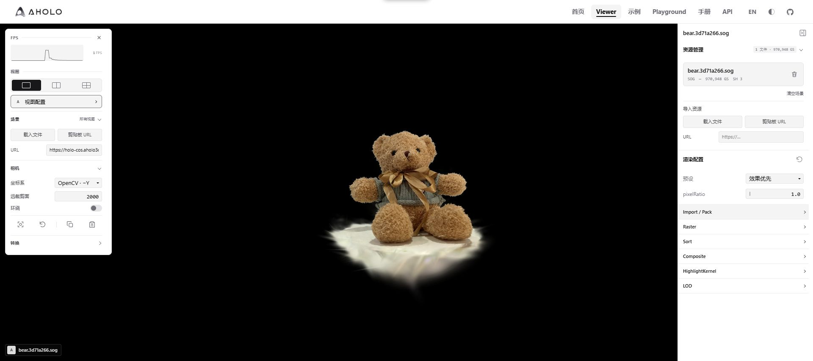
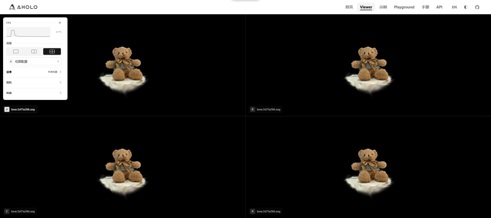

## 界面结构

[`Viewer`](../../viewer/) 是基于 `@manycore/aholo-viewer` 的在线查看器，用于查看 3DGS、GLTF / GLB 和分块 LOD 资源，并在不同视图中对比渲染配置。



截图展开了场景、相机和资源管理。首次打开时，左侧控制面板展开，右侧属性面板收起。

| 区域         | 功能与作用范围                                                                                                            |
| ------------ | ------------------------------------------------------------------------------------------------------------------------- |
| 左侧控制面板 | FPS、视图数量，以及场景、相机、转换工具。“场景”中的导入覆盖所有已创建视图；相机工具操作当前视图，开启同步后影响其他视图。 |
| 中间画布     | 查看模型、操作相机、拖入资源。左下角 A–D 标识当前视图，旁边显示可编辑的名称。                                             |
| 右侧资源管理 | 管理当前视图的资源。列表在上、追加导入在下，整个模块默认收起。                                                            |
| 右侧渲染配置 | 当前视图的预设及 SDK 参数，按 Import / Pack、Raster、Sort、Composite、HighlightKernel、LOD 分组。                         |

点击左侧“视图配置”打开属性面板，右上角图标将其收起。面板展开不会改变画布尺寸；标题显示当前视图名称。“渲染配置”标题右侧的重置图标恢复当前视图的全部渲染默认值。图标和分组标题上的悬停提示提供操作说明。

## 快速开始

1. 打开“视图配置”，选择预设。初始档位是“效果优先”；`packType` 和 `maxShDegree` 应在导入前确定。
2. 点击空场景选择文件，或直接拖入文件。一次可选择多个模型；GLTF 请同时提供 `.bin` 和纹理，也可以拖入完整文件夹。
3. 加载完成后，空场景会自动聚焦本批模型。需要重新构图时，使用左侧“相机”中的“聚焦模型”。
4. 修改右侧参数查看效果。需要对比时先创建双视图或四视图，再从左侧“场景”载入同一批资源。

## 资源导入与管理

### 导入入口的区别

| 入口                                  | 作用范围       | 已有资源                     |
| ------------------------------------- | -------------- | ---------------------------- |
| 点击空场景                            | 当前视图       | 载入所选批次                 |
| 左侧“场景”的文件、URL、剪贴板 URL     | 所有已创建视图 | 整批覆盖                     |
| 右侧“导入资源”的文件、URL、剪贴板 URL | 当前视图       | 追加                         |
| 拖入画布                              | 鼠标所在视图   | 默认整批替换；按住 Ctrl 追加 |

URL 输入后按 Enter 确认，也可以粘贴多个以空格、换行或逗号分隔的 URL。Ctrl 仅改变拖入行为。切换视图数量不会自动复制模型；先创建需要的视图，再通过左侧统一导入。

### 支持的资源

- **3DGS**：PLY、SPZ、SPLAT、KSPLAT、SOG、ESZ，以及 LCC / LCC2 ZIP。普通 GS 通过 Worker 解析并分块上传到 GPU，不保留完整的 CPU 编码副本；上传完成后显示模型，并按整批包围盒聚焦。
- **GLTF / GLB**：本地 GLTF 的配套文件需要一起选择或拖入；URL 导入按模型 URL 解析相对路径。材质和扩展以当前加载器支持范围为准，展示模型的静态姿态。
- **分块 LOD**：通过 URL 导入 `lod-meta.json`。清单及分块文件需由 HTTP 服务或 CDN 承载，分块路径相对于清单 URL 解析，见下方本地服务步骤。

资源列表显示格式、本地文件大小，以及高斯数量、SH 阶数或网格数量。删除图标仅移除该条资源；加载中可取消，失败后可重试。“清空场景”移除当前视图的全部资源。移除资源或减少视图数量会释放对应资源。

## 多视图与对比



左侧“视图”提供单视图、双视图和四视图。每个视图的渲染参数独立；“同步相机”只同步相机状态，适合在相同构图下比较不同参数。

| 操作                         | 结果                                                                 |
| ---------------------------- | -------------------------------------------------------------------- |
| 点击画面，或按 1 / 2 / 3 / 4 | 激活已创建的 A / B / C / D 视图；输入框编辑期间不触发                |
| 双击画布                     | 放大当前视图，再次双击恢复原拆分布局与比例                           |
| 放大后点击底部中央 A–D       | 切换当前显示的视图                                                   |
| 放大后聚焦画布并按住 Space   | 临时查看上一次激活的视图，松开返回；没有历史选择时使用第一个其他视图 |
| 双击左下角名称               | 编辑名称，失去焦点保存；留空恢复自动名称，仅保留到当前页面会话结束   |
| F11                          | 进入或退出浏览器全屏，隐藏或恢复页面导航                             |
| Esc                          | 优先收起属性面板，否则退出放大；编辑输入时不触发                     |

拖动分隔线调整尺寸；双视图与四视图分别保留比例。四视图支持调整左右列宽和上下行高，手机上的双视图上下排列。每侧至少占 15%，靠近中心时吸附等分。双击分隔线恢复等分；聚焦分隔线后，方向键每次调整 2%，Home 或 Enter 恢复等分。

**拆分数量决定实际视图数量。** 四视图切回双视图会销毁 C、D，切回单视图会销毁 B–D，并释放模型；之后重新创建视图时可恢复已缓存的渲染参数，但需要重新导入模型。双击放大只是显示切换，不销毁其他视图。

## 相机

默认坐标系为 OpenCV（−Y 向上），也可选择 OpenGL（+Y 向上）或 Aholo（+Z 向上）。空场景首个导入资源为 GLTF / GLB 时自动使用 OpenGL。

| 输入或工具          | 行为                                             |
| ------------------- | ------------------------------------------------ |
| 左键拖动            | 调整朝向；开启“环绕”后围绕模型包围盒中心旋转     |
| Alt + 左键拖动      | 临时环绕                                         |
| 右键 / 中键拖动     | 平移                                             |
| 滚轮                | 沿视线方向前后移动                               |
| W / S、A / D、Q / E | 前后、左右、升降；Shift、Ctrl、CapsLock 可加速   |
| R / F               | 滚转                                             |
| 聚焦模型 / 重置视角 | 分别将模型放入画面，或恢复当前坐标系的初始视角   |
| 复制状态 / 粘贴状态 | 通过剪贴板保存和恢复相机位置、朝向、裁剪面等状态 |

开启环绕保留当前相机位置、朝向与构图，首次拖动不会强制转向包围盒中心。需要主动对准模型时使用“聚焦模型”。

## 渲染配置、预设与缓存

五档预设为**极限效果、效果优先、均衡模式、性能优先、极限性能**。无有效缓存时默认使用效果优先：Compressed、SH 3；统一默认值包括 `pixelRatio = 1`、`repackEnabled = true`、`radial = false`，LOD 预算为 600 万、并行任务数为 8。

切换预设只更新 **12 项档位参数**，保留 **25 项统一参数**，包括 pixelRatio、Repack、Radial、模糊、排序阈值、色调映射、曝光、HighlightKernel 和 LOD。修改档位参数会显示“自定义”；修改统一参数不会改变档位。完整数值与 SDK 对应关系见 [3DGS 预设配置](./3dgs-preset-config.md)。

参数名使用 SDK 字段名。数值可直接输入或拖动调整，`maxShDegree` 的范围为 0–3。`packType` 和 `maxShDegree` 在下次导入时生效，不会重新解析已加载资源；其他渲染配置会应用到当前视图。面板 `maxStdDev` 显示 5–8，传入 SDK 时取平方根。

配置按 A–D 自动保存在当前浏览器，刷新后恢复。缓存带有 `v1` 版本；版本缺失或不一致时直接使用默认值。重置图标同时恢复档位与统一参数。模型、相机和自定义视图名称不随渲染配置保存；已有有效缓存优先于新的默认值。

左侧 FPS 曲线表示整个查看器的帧率，包含当前可见视图。收起控制面板后，左上角保留 FPS 数值入口。图形上下文丢失时会显示提示，需要重新加载页面并导入资源。

## 格式转换

展开左侧“转换”，选择一个或多个 3DGS 文件，指定 PLY、SPZ 或 SPLAT，然后点击“转换并下载”。多个源文件合并为一个输出，转换在浏览器内完成并可取消。GLTF / GLB 和分块 LOD 清单不支持转换为单个 3DGS 文件。大型资产批处理请使用 [splat-transform](./splat-transform.md)。

## 本地 LOD 服务

使用 [`splat-transform`](./splat-transform.md) 生成分块资源后，将整个输出目录交给本地服务：

```bash
npm install -g @manycore/aholo-splat-dev-server
splat-dev-server ./chunk-lod --address 127.0.0.1 --port 3000
```

在 Viewer 的 URL 输入框填入 `http://127.0.0.1:3000/lod-meta.json` 并按 Enter。保持服务运行，以便相机移动时继续加载分块；浏览器如请求本地网络访问权限，需允许后才能载入。

多个分块结果可先合并，再承载合并后的目录：

```bash
merge-lod -i ./part-a/lod-meta.json ./part-b/lod-meta.json -o ./merged-lod
splat-dev-server ./merged-lod
```

数据格式和调度配置见 [Chunk LOD](./chunk-lod.md)。
